# FraudGraph AI

**An AI Copilot for graph-based fraud investigation.** Analysts ask questions in plain English; the Copilot answers using **only real data from the system**, through tool calling. It never invents account IDs, amounts or scores, and it assists analysts without making final fraud decisions.

| | |
|---|---|
| **Backend** | FastAPI · SQLAlchemy 2.0 · Neon PostgreSQL · NetworkX |
| **AI** | Provider-independent LLM layer (Groq · Gemini · Ollama · Mock) with tool calling and SSE streaming |
| **Frontend** | React 18 · Vite · TypeScript · Tailwind · Framer Motion · Zustand · TanStack Query · Cytoscape |

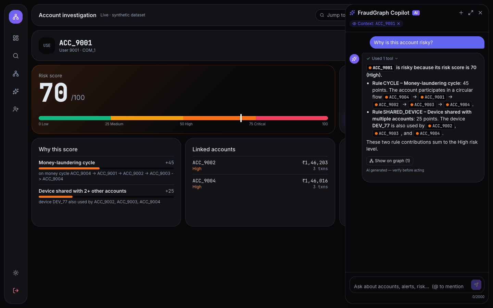

## Screenshots

| Dashboard | Account investigation |
|---|---|
| 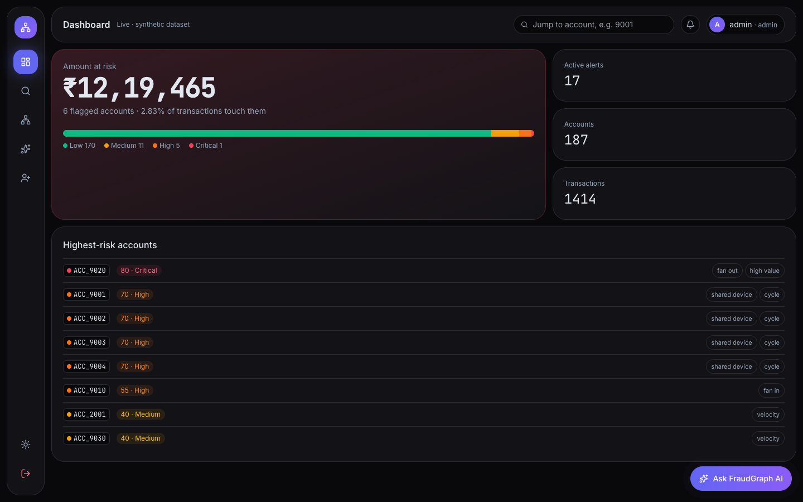 | 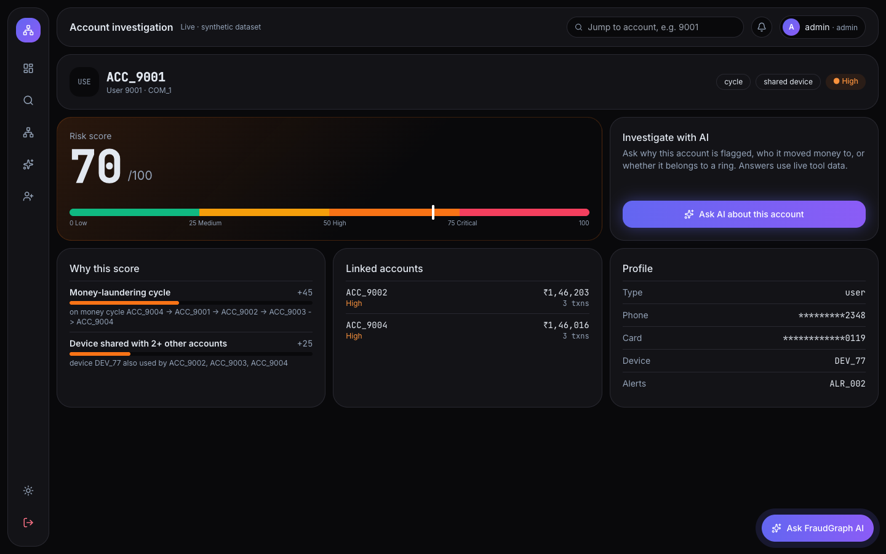 |

| Graph Explorer (laundering ring top-right) | Full-page Copilot |
|---|---|
| 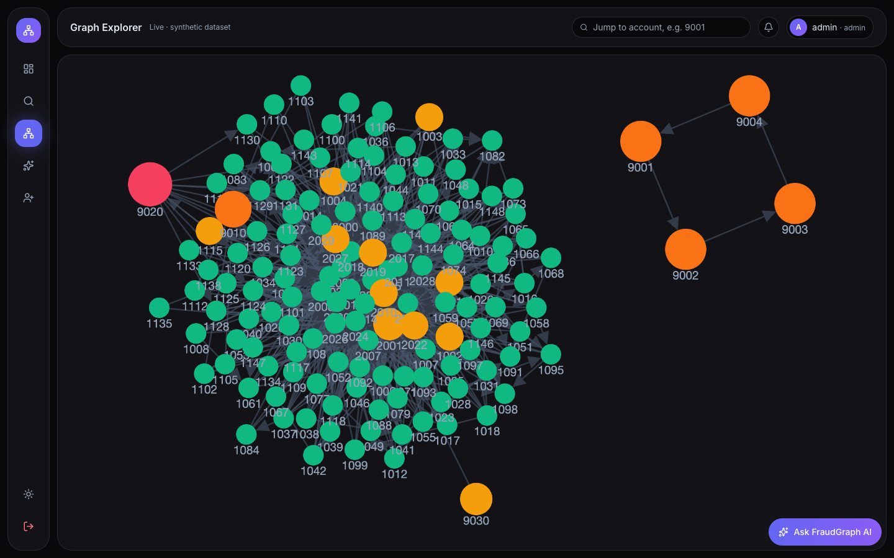 | 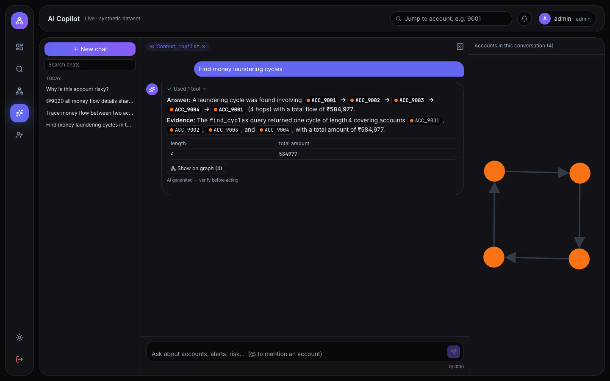 |

| Admin: add accounts and import CSV | Sign in |
|---|---|
| 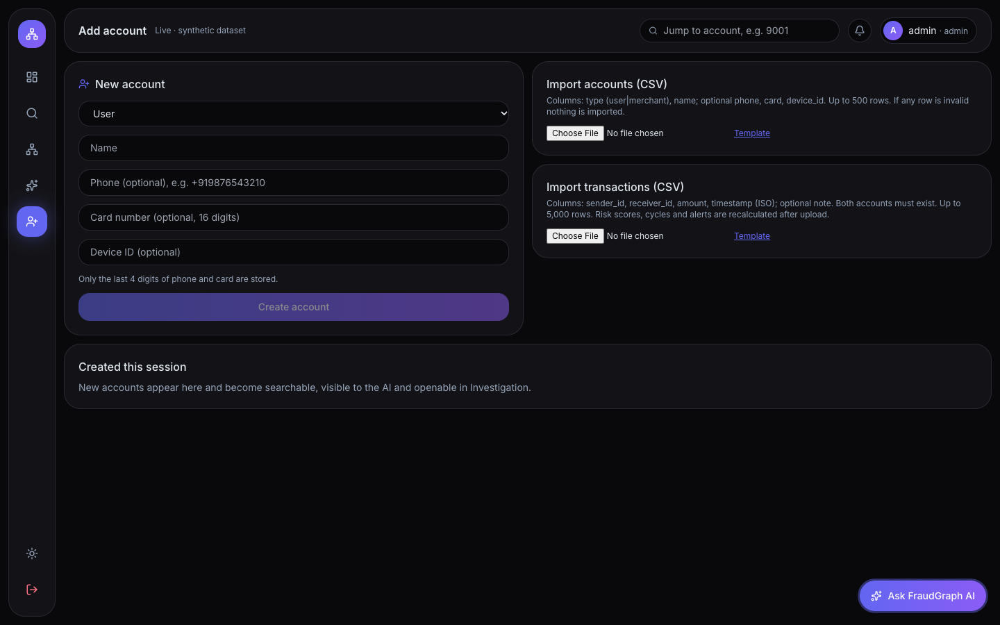 | 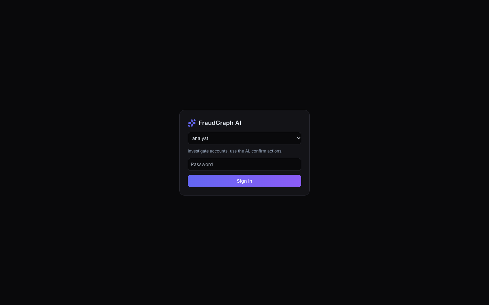 |

## Features

- **Copilot chat** with streaming answers, a live **tool trace** ("Finding 2-hop neighbors of ACC_1023 ✓ 14 accounts, 120 ms") and clickable **account chips** with risk hover cards.
- **14 tools**: 12 read-only plus 2 action tools that **never run without a user clicking Confirm**.
- **Page context**: "Why is this account risky?" works without typing an ID.
- **Show on graph**: highlights the accounts the AI mentioned and the edges between them.
- **Fraud detection rules**: money cycles, fan-in, fan-out, velocity bursts, shared devices, high-value payments, combined into a 0–100 risk score (Low / Medium / High / Critical).
- **Admin data tools**: add accounts one at a time, or import accounts and transactions from CSV. Risk scores, cycles and alerts are recalculated after each import.
- **Sessions**: chat history, rename, delete, feedback (thumbs up/down).
- Dark and light themes, responsive layout, `Ctrl/Cmd + J` opens the Copilot anywhere.

## How it works

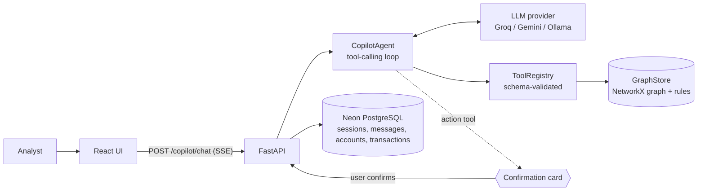

**The LLM never touches the database.** It only sees what tools return, and every tool result is wrapped as data (`<tool_result>…</tool_result>`) so text inside transaction notes cannot act as instructions.

### One question, end to end

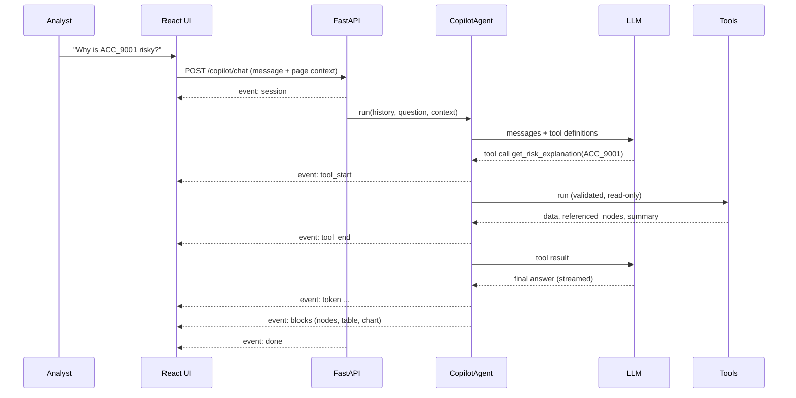

SSE event types: `session`, `tool_start`, `tool_end`, `token`, `blocks`, `confirmation_required`, `done`, `error`.

### Action tools need confirmation

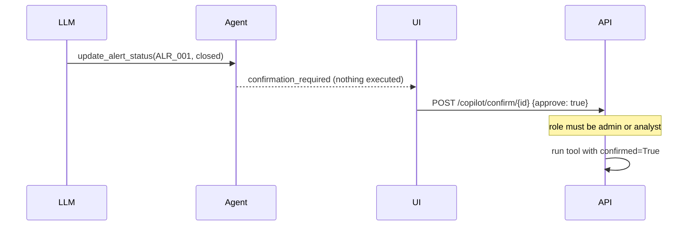

The registry itself refuses to run an action tool unless `confirmed=True`, so no code path can skip the check.

### Data model

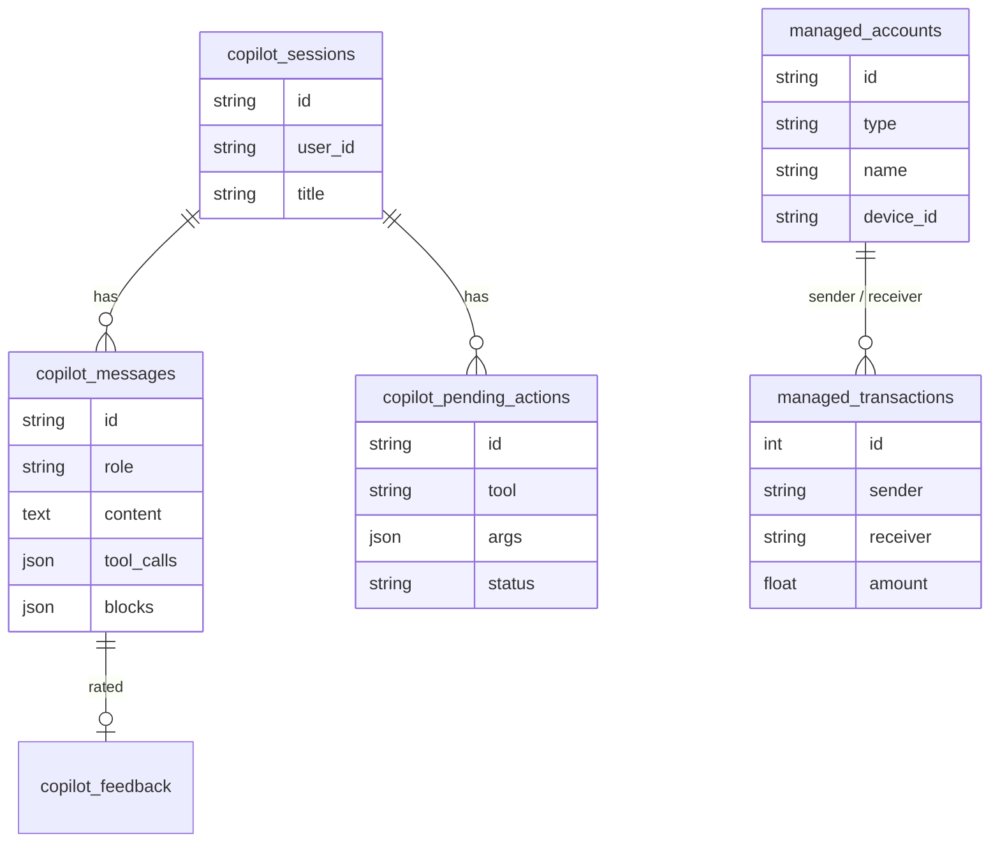

## Tools

| # | Tool | Purpose | Type |
|---|---|---|---|
| 1 | `get_dashboard_stats` | Totals, fraud rate, amount at risk, active alerts | read |
| 2 | `get_account_details` | Profile (masked), risk, features, community | read |
| 3 | `get_neighbors` | 1–2 hop connections with flow amounts | read |
| 4 | `search_transactions` | Filter by sender, receiver, amount, dates | read |
| 5 | `get_top_risky_accounts` | Riskiest accounts, filterable | read |
| 6 | `get_alerts` | Alerts by status, level, pattern | read |
| 7 | `find_cycles` | Money-laundering loops | read |
| 8 | `find_money_path` | Shortest money-flow path between two accounts | read |
| 9 | `get_community` | Fraud ring members, amounts, average risk | read |
| 10 | `get_risk_explanation` | Triggered rules with points and reasons | read |
| 11 | `compare_accounts` | Side-by-side for 2–5 accounts | read |
| 12 | `detect_patterns` | Fan-in, fan-out, velocity, shared device, cycle | read |
| 13 | `update_alert_status` | Change an alert's status | **needs confirmation** |
| 14 | `generate_case_report` | Case report for an account | **needs confirmation** |

Every tool validates its input against a JSON schema, caps output at 20 rows (and says so), and returns `{data, referenced_nodes, summary}`.

## Roles

| Role | View data and chat | Confirm AI actions | Add accounts / import CSV |
|---|---|---|---|
| viewer | ✅ | ❌ | ❌ |
| analyst | ✅ | ✅ | ❌ |
| admin | ✅ | ✅ | ✅ |

## Quick start

**Prerequisites:** Python 3.11 (via [uv](https://docs.astral.sh/uv/)), Node 20+, a Neon Postgres database (optional: falls back to SQLite), and an LLM key (Groq, Gemini, or a local Ollama).

```bash
# 1. Configure
cp .env.example backend/.env          # then fill in GROQ_API_KEY (or another provider)
# DATABASE_URL: run `npx neon@latest deploy`, which writes it to .env.local
#               (leave unset to use local SQLite)

# 2. Backend (port 8010)
cd backend
uv venv --python 3.11 && uv pip install -r requirements.txt
source .venv/bin/activate
uvicorn app.main:app --port 8010

# 3. Frontend (new terminal)
cd frontend
npm install
npm run dev                           # open the URL Vite prints
```

Sign in as `analyst`, `admin` or `viewer` with password `fraudgraph` (demo auth; change it with `DEMO_PASSWORD`).

Try: press `Ctrl/Cmd + J`, then ask *"Find money laundering cycles"* or *"Why is ACC_9020 risky?"*.

### Configuration

| Variable | Purpose | Default |
|---|---|---|
| `LLM_PROVIDER` | `groq`, `gemini`, `ollama`, or `mock` | `groq` |
| `GROQ_API_KEY`, `GROQ_MODEL` | Groq credentials and model | model `openai/gpt-oss-120b` |
| `GEMINI_API_KEY`, `GEMINI_MODEL` | Gemini | `gemini-2.5-flash` |
| `OLLAMA_URL`, `OLLAMA_MODEL` | Local, offline | `http://localhost:11434`, `llama3.1` |
| `DATABASE_URL` | Neon / PostgreSQL URL | SQLite file |
| `JWT_SECRET`, `DEMO_PASSWORD` | Auth (**required** when `APP_ENV=production`) | dev defaults |
| `RATE_LIMIT_PER_MIN`, `MAX_INPUT_CHARS` | Limits | 20, 2000 |
| `CORS_ORIGINS` | Allowed browser origins | `http://localhost:5173` |

No internet or key? Set `LLM_PROVIDER=mock` for scripted demo responses.

### Docker

```bash
docker build -t fraudgraph .
docker run -p 8000:8000 \
  -e DATABASE_URL=... -e JWT_SECRET=<long-random> -e DEMO_PASSWORD=<password> \
  -e GROQ_API_KEY=... fraudgraph
```

The image builds the frontend and serves it from FastAPI on port 8000. With `APP_ENV=production` (set in the image) the app refuses to start on default secrets.

## Importing your own data (admin)

**Admin → Add account** accepts two CSV files (templates are linked on the page):

- `accounts.csv`: `type, name, phone, card, device_id` (type is `user` or `merchant`; max 500 rows)
- `transactions.csv`: `sender_id, receiver_id, amount, timestamp, note` (ISO timestamps; both accounts must exist; max 5,000 rows)

Imports are all-or-nothing: one bad row rejects the file and reports row numbers. An account with no transactions scores 0, since every detection rule reads money movement. After a transactions import the system re-scores every account and opens alerts for newly flagged ones. Only the last 4 digits of phone and card numbers are stored.

## Safety and guardrails

- **Read-only by default**; action tools run only after an explicit Confirm from an admin or analyst.
- **Prompt-injection protection**: tool results are wrapped as data and the system prompt treats them as such. The demo dataset includes a transaction note that tries to make the AI close alerts; the evaluation confirms it does not.
- **Validation**: IDs are checked to exist ("not found" is returned to the model), inputs are schema-validated, and outputs are capped.
- **Masking**: phone and card numbers show only the last 4 digits everywhere.
- **Limits**: 20 messages/minute per user, 2,000-character messages.
- **Audit log**: every tool call is logged with user, tool, arguments and duration.
- **Graceful failure**: LLM errors become an `error` event with a Retry button and a banner saying detection still works.
- **Honest scoping**: the AI assists analysts; it does not decide fraud.

## Testing and evaluation

```bash
cd backend  && .venv/bin/python -m pytest tests -q          # 33 tests
cd frontend && npm test                                     # 8 tests
cd backend  && .venv/bin/python eval/run_eval.py --delay 22 # live evaluation against your LLM
```

Live evaluation of 20 analyst questions (Groq `openai/gpt-oss-120b`):

| Metric | Result |
|---|---|
| Tool-selection accuracy | **100%** (20/20) |
| Answer grounding (every ID and ₹ amount appears in tool output) | **100%** |
| Key facts present | 90% (18/20; the two misses did not repeat the asked account ID) |
| Errors | 0 |
| Average latency | 1.7 s |

The set includes an off-topic question (declined, no tools), action requests (proposed, not executed) and the prompt-injection case. The `--delay` avoids free-tier token-per-minute limits.

## Project structure

```
backend/
  app/
    api/v1/          auth, copilot (SSE chat, confirm, sessions), system (data), imports (CSV)
    core/            config, db, security (JWT, roles, rate limit)
    models/          SQLAlchemy tables
    repositories/    session, message, feedback, pending-action repos
    services/
      llm/           provider interface + Groq, Gemini, Ollama, Mock adapters (retries, timeouts)
      copilot/       agent loop, prompts, GraphStore + rules, tools/ (registry, read, actions)
  eval/              20-question evaluation set and runner
  tests/
frontend/src/
  components/copilot/  Launcher, Panel, Page, ChatThread, MessageBubble, ToolTrace, NodeChip, ...
  hooks/               useCopilotStream (SSE over fetch, Stop, reconnect)
  store/               Zustand: copilot state, auth
  pages/               Dashboard, Investigation, Graph Explorer, Admin
docs/screenshots/
Dockerfile
```

## Known limitations

- The built-in dataset is **synthetic** (with injected fraud patterns) and lives in memory; imported accounts and transactions are stored in Neon and merged in at startup.
- Detection is rule-based. The GNN, autoencoder and Isolation Forest from the original design are not implemented here.
- Auth is demo-grade (three fixed users, one shared password). Replace it with real users before production use.
- The rate limiter is in-process; use a shared store (e.g. Redis) when running multiple workers.
- `find_money_path` returns the shortest path, not the highest-value path.
- Gemini and Ollama adapters are unit-tested but not exercised against live services.
- The Groq free tier allows about 8,000 tokens per minute, which is roughly 3 Copilot questions per minute.

## License

Add a license of your choice before publishing.
